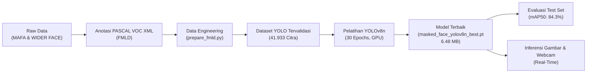
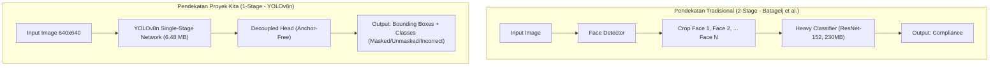
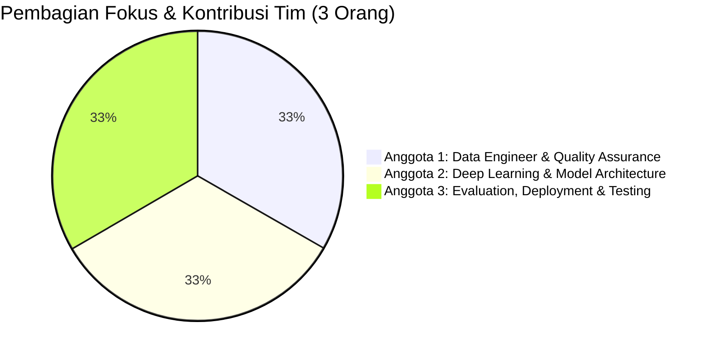

# 😷 LAPORAN PROYEK AKHIR DEEP LEARNING: END-TO-END MASKED FACE DETECTION (MFD)
**Sistem Deteksi Spasial dan Klasifikasi Kepatuhan Penggunaan Masker Wajah Berbasis YOLOv8 Nano**

---

> **Informasi Proyek:**
> - **Kategori:** Tugas Besar Mata Kuliah Deep Learning (Computer Vision)
> - **Ukuran Tim:** 3 Orang Mahasiswa
> - **Model Utama:** YOLOv8n (Fine-tuned pada FMLD)
> - **Ukuran Bobot Model (*Weight*):** ± 6.48 MB (`paket_hasil/masked_face_yolov8n_best.pt`)
> - **Kinerja Akhir (mAP@50 Test Set):** **84.3%** (*Overall*), **97.3%** (*Masked Face*), **86.3%** (*Unmasked Face*), **69.3%** (*Incorrectly Masked Face*)
> - **Status Dataset:** 41.933 citra beranotasi tervalidasi (31.304 Train, 3.477 Val, 7.152 Test)

---

## DAFTAR ISI
1. [Ringkasan Eksekutif (Executive Summary)](#1-ringkasan-eksekutif-executive-summary)
2. [Latar Belakang & Rumusan Masalah](#2-latar-belakang--rumusan-masalah)
3. [Tujuan Proyek](#3-tujuan-proyek)
4. [Eksplorasi & Rekayasa Dataset (Data Engineering)](#4-eksplorasi--rekayasa-dataset-data-engineering)
   - [4.1 Sumber Data FMLD, MAFA, & WIDER FACE](#41-sumber-data-fmld-mafa--wider-face)
   - [4.2 Konversi Anotasi: PASCAL VOC XML ke Format YOLO](#42-konversi-anotasi-pascal-voc-xml-ke-format-yolo)
   - [4.3 Strategi Menangani *Class Imbalance* (Stratified Split)](#43-strategi-menangani-class-imbalance-stratified-split)
   - [4.4 Pembersihan Data (Data Cleaning & Filtering)](#44-pembersihan-data-data-cleaning--filtering)
   - [4.5 Distribusi Data Akhir](#45-distribusi-data-akhir)
5. [Audit Mutu & Validasi Data (`check_dataset.py`)](#5-audit-mutu--validasi-data-check_datasetpy)
6. [Arsitektur Model Deep Learning: YOLOv8 Nano](#6-arsitektur-model-deep-learning-yolov8-nano)
   - [6.1 Mengapa YOLOv8n Menggantikan Arsitektur Klasik (ResNet/2-Stage)?](#61-mengapa-yolov8n-menggantikan-arsitektur-klasik-resnet2-stage)
   - [6.2 Komponen Arsitektur: Backbone, Neck, dan Head](#62-komponen-arsitektur-backbone-neck-dan-head)
   - [6.3 Fungsi Kerugian (Loss Functions)](#63-fungsi-kerugian-loss-functions)
7. [Proses Pelatihan & Eksperimen (Training Pipeline)](#7-proses-pelatihan--eksperimen-training-pipeline)
   - [7.1 Konfigurasi Hyperparameter](#71-konfigurasi-hyperparameter)
   - [7.2 Augmentasi Citra Selama Pelatihan](#72-augmentasi-citra-selama-pelatihan)
   - [7.3 Kendala Teknis Lapangan & Solusinya (*Engineering Workaround*)](#73-kendala-teknis-lapangan--solusinya-engineering-workaround)
   - [7.4 Analisis Konvergensi Loss Pelatihan](#74-analisis-konvergensi-loss-pelatihan)
8. [Evaluasi Kinerja & Pengujian Mendalam (Evaluation & Testing)](#8-evaluasi-kinerja--pengujian-mendalam-evaluation--testing)
   - [8.1 Kinerja pada Validation Set](#81-kinerja-pada-validation-set)
   - [8.2 Kinerja pada Test Set Independen](#82-kinerja-pada-test-set-independen)
   - [8.3 Analisis F1-Score & Ambang Batas (*Confidence Threshold*) Optimal](#83-analisis-f1-score--ambang-batas-confidence-threshold-optimal)
   - [8.4 Analisis Matriks Konfusi (*Confusion Matrix*)](#84-analisis-matriks-konfusi-confusion-matrix)
9. [Inferensi & Demonstrasi Sistem (*Inference & Demo*)](#9-inferensi--demonstrasi-sistem-inference--demo)
   - [9.1 Pengujian Gambar Statis (*Batch Image Demo*)](#91-pengujian-gambar-statis-batch-image-demo)
   - [9.2 Pengujian Video Real-Time (*Webcam Stream*)](#92-pengujian-video-real-time-webcam-stream)
10. [Panduan Menjalankan Proyek (Reproduction Guide)](#10-panduan-menjalankan-proyek-reproduction-guide)
11. [Rekomendasi Pembagian Kerja Tim (3 Orang)](#11-rekomendasi-pembagian-kerja-tim-3-orang)
12. [Manfaat & Kegunaan Nyata Proyek (Real-World Applications)](#12-manfaat--kegunaan-nyata-proyek-real-world-applications)
13. [Keterbatasan Sistem & Rencana Pengembangan Mendatang](#13-keterbatasan-sistem--rencana-pengembangan-mendatang)
14. [Kesimpulan](#14-kesimpulan)

---

## 1. Ringkasan Eksekutif (Executive Summary)

Proyek ini berjudul **Masked Face Detection (MFD)**, sebuah sistem deteksi objek (*object detection*) berbasis *Deep Learning* yang dirancang untuk mendeteksi posisi spasial wajah manusia dalam gambar maupun video bergerak secara *real-time*, sekaligus mengklasifikasikan tingkat kepatuhan pemakaian masker ke dalam 3 kelas:
1. `masked_face`: Memakai masker medis/kain dengan benar (menutup hidung dan mulut).
2. `unmasked_face`: Tidak memakai masker sama sekali.
3. `incorrectly_masked_face`: Memakai masker namun keliru (misalnya melorot di bawah hidung atau hanya tersangkut di dagu).

Proyek ini dibangun menggunakan arsitektur **YOLOv8 Nano (YOLOv8n)** dari Ultralytics yang di-*fine-tune* menggunakan dataset **Face Mask Label Dataset (FMLD)** skala besar (gabungan basis data citra MAFA dan WIDER FACE) dengan total **41.933 citra**.

**Pencapaian Kunci Proyek:**
- Bobot model sangat ringkas (**6.48 MB**), siap dipasang pada perangkat berspesifikasi rendah (*edge computing* / laptop biasa / CCTV cerdas).
- Model mencapai skor **mAP@50 sebesar 84.3%** pada set pengujian resmi (*test set* FMLD 7.152 gambar).
- Deteksi wajah bermasker benar mencapai akurasi luar biasa (**mAP@50 = 97.3%**).
- Mampu mendeteksi masker yang melorot/salah pakai (**mAP@50 = 69.3%**), meskipun kelas ini sangat langka dalam data riil (hanya ~2.4% dari total objek).
- Sistem telah diuji secara *end-to-end*, mulai dari konversi format dataset, validasi mutu data tanpa kesalahan (*0 error*), pelatihan transfer learning 30 epoch di GPU, hingga inferensi *live stream* webcam secara mulus.



---

## 2. Latar Belakang & Rumusan Masalah

### 2.1 Mengapa Bukan Sekadar Klasifikasi Biner Biasa?
Di awal pandemi COVID-19 maupun dalam protokol kebersihan laboratorium/industri makanan, banyak sistem berbasis kecerdasan buatan dibuat hanya dengan pendekatan **klasifikasi biner** (*Mask* vs *No Mask*). Pendekatan tersebut memiliki dua kelemahan fatal:
1. **Tidak Ada Lokalisasi Spasial:** Klasifikasi gambar penuh tidak tahu siapa yang memakai masker dan di mana posisinya jika dalam satu gambar terdapat kerumunan (banyak orang).
2. **Mengabaikan "False Compliance" (Kepatuhan Semu):** Sering kali seseorang merasa sudah patuh memakai masker, namun masker tersebut ditarik ke bawah hidung atau dipasang di leher/dagu. Masker yang melorot sama sekali **tidak memberikan perlindungan transmisi aerosol** dari saluran pernapasan atas.

### 2.2 Tantangan Lingkungan Nyata (*In-the-Wild Challenges*)
Dalam kondisi nyata di stasiun, pusat perbelanjaan, atau gerbang gedung:
- Wajah orang tidak selalu menghadap tegak ke kamera (*head pose* menyamping, menunduk, atau menengadah).
- Skala wajah bervariasi drastis: ada yang sangat dekat dengan kamera, ada yang berukuran sangat kecil di latar belakang (*scale variation*).
- Oklusi: wajah terhalang tangan, kacamata, topi, atau orang lain di kerumunan.
- **Ketidakseimbangan Kelas Ekstrem (*Severe Class Imbalance*):** Sebagian besar orang di dunia nyata berada pada kondisi "memakai masker penuh" atau "tidak memakai masker". Kondisi "masker melorot" jauh lebih sedikit jumlahnya, sehingga model AI rentan bias dan gagal mendeteksi kelas minoritas ini.

---

## 3. Tujuan Proyek

1. **Membangun Model Deteksi Objek 1-Stage:** Menghasilkan sistem deteksi cepat dan akurat yang langsung melokalisasi koordinat wajah (*bounding box*) sekaligus memprediksi status pemakaian masker dalam satu kali inferensi (*one-shot*).
2. **Mengimplementasikan Rekayasa Data Andal:** Mengonversi dataset publik terstandar (FMLD berformat XML) ke dalam standar YOLO, menyaring data cacat, dan menerapkan pemisahan data berstrata (*stratified splitting*) agar kelas langka tetap terwakili secara adil.
3. **Mengoptimalkan Akurasi vs Kecepatan (*Speed-Accuracy Tradeoff*):** Memilih model yang ringan (**YOLOv8 Nano**) agar dapat beroperasi pada kecepatan tinggi (*real-time* >30 FPS) tanpa memerlukan GPU industri yang mahal.
4. **Validasi dan Pengujian Berstandar Akademik:** Mengukur performa model dengan metrik standar industri *Computer Vision* (Precision, Recall, F1-Score, mAP@0.5, mAP@0.5:0.95, serta Confusion Matrix).
5. **Menyediakan Prototipe Aplikasi:** Menyediakan modul inferensi untuk pengujian gambar acak maupun tangkapan kamera langsung (*live webcam*).

---

## 4. Eksplorasi & Rekayasa Dataset (Data Engineering)

Dataset adalah fondasi utama dari sistem *Deep Learning*. Keberhasilan proyek ini sangat bergantung pada skrip persiapan data yang dibuat oleh tim, yaitu [`prepare_fmld.py`](file:///c:/Users/andika%20wahyu%20pratama/mfd/prepare_fmld.py).

### 4.1 Sumber Data FMLD, MAFA, & WIDER FACE
Proyek ini mengacu pada penelitian MDPI Applied Sciences (2021) berjudul *"How to Correctly Detect Face-Masks for COVID-19 from Visual Information?"* oleh Batagelj dkk., yang merilis dataset **FMLD (Face Mask Label Dataset)**:
- **MAFA (Masked Faces):** Menyumbangkan ribuan citra wajah yang memakai berbagai jenis masker (masker bedah, masker kain bergambar, respirator N95).
- **WIDER FACE:** Dataset benchmark deteksi wajah berskala besar yang menyumbangkan variasi pose, ekspresi, pencahayaan, kerumunan, dan wajah tanpa masker di kondisi liar.

Anotasi FMLD disediakan dalam arsip `FMLD_annotations.zip` yang terbagi menjadi subfolder `train/` dan `test/`. Masing-masing file berupa format **PASCAL VOC XML**.

### 4.2 Konversi Anotasi: PASCAL VOC XML ke Format YOLO
Anotasi PASCAL VOC mendefinisikan kotak wajah menggunakan koordinat piksel absolut sudut kiri atas dan kanan bawah:
$$\text{VOC Bounding Box} = [x_{min}, y_{min}, x_{max}, y_{max}]$$

Sedangkan arsitektur YOLO membutuhkan anotasi teks (`.txt`) dengan nilai ternormalisasi (rentang 0.0 sampai 1.0) berbasis titik tengah, lebar, dan tinggi:
$$x_{center} = \frac{x_{min} + x_{max}}{2 \times W}, \quad y_{center} = \frac{y_{min} + y_{max}}{2 \times H}$$
$$w = \frac{x_{max} - x_{min}}{W}, \quad h = \frac{y_{max} - y_{min}}{H}$$

Skrip [`prepare_fmld.py`](file:///c:/Users/andika%20wahyu%20pratama/mfd/prepare_fmld.py) secara otomatis membaca dimensi gambar ($W, H$), mengekstrak tag XML, menghitung konversi matematika di atas, serta memotong nilai koordinat yang keluar dari batas gambar (*clipping*).

### 4.3 Strategi Menangani *Class Imbalance* (Stratified Split)
Dalam dataset asli FMLD, hanya ada folder `train` dan `test`. Jika folder `train` dipecah menjadi `train` dan `val` secara acak murni (*pure random split*), terdapat risiko besar bahwa kelas langka (`incorrectly_masked_face`) tidak terdistribusi secara seimbang di set validasi.

Tim menerapkan **Stratified Sampling Berbasis Objek Langka**:
1. Skrip membagi seluruh citra dalam set pelatihan menjadi dua kelompok:
   - **Kelompok Langka (*Rare Group*):** Semua citra yang memuat setidaknya 1 objek `incorrectly_masked_face`.
   - **Kelompok Umum (*Rest Group*):** Citra yang hanya memuat `masked_face` dan/atau `unmasked_face`.
2. Kedua kelompok dikocok (*shuffle*) menggunakan *seed* tetap (`seed=42`) agar hasilnya dapat direproduksi (*reproducible*).
3. Diambil secara proporsional tepat **10%** dari kelompok langka dan **10%** dari kelompok umum untuk dialokasikan ke folder `val` (validasi), sedangkan 90% sisanya tetap di `train`.
4. Folder `test` resmi FMLD (7.152 citra) **sama sekali tidak disentuh** selama pelatihan untuk menjamin keabsahan evaluasi akhir.

### 4.4 Pembersihan Data (Data Cleaning & Filtering)
Selama pemrosesan XML, dilakukan penyaringan ketat:
- **Mengabaikan Kelas Non-Target:** Anotasi yang berlabel `invalid_face` (misalnya kepala patung, gambar anime, atau wajah yang terpotong terlalu parah) dibuang. Tercatat sebanyak **2.856 objek** `invalid_face` berhasil disaring.
- **Penyaringan Anotasi Sulit (*Difficult Flag*):** Pada subset pengujian, anotasi berlabel `difficult=1` (wajah yang nyaris tidak terlihat oleh mata manusia) diabaikan sesuai standar evaluasi FMLD resmi. Sebanyak **11.860 objek** `difficult` disaring.
- **Penyaringan Kotak Rusak (*Degenerate Boxes*):** Kotak dengan lebar atau tinggi kurang dari 2 piksel dieliminasi (ditemukan 1 kasus anomali).

### 4.5 Distribusi Data Akhir
Berdasarkan log rekayasa data [`dataset_summary.json`](file:///c:/Users/andika%20wahyu%20pratama/mfd/fmld_yolo/dataset_summary.json) dan ringkasan audit data:

| Subset Data | Jumlah Citra | `masked_face` (0) | `unmasked_face` (1) | `incorrectly_masked_face` (2) | Total Bounding Box | Rasio Kelas Langka |
| :--- | :---: | :---: | :---: | :---: | :---: | :---: |
| **Train** | **31.304** | 22.190 | 22.070 | 1.086 | 45.346 | **2.39%** |
| **Validation** | **3.477** | 2.412 | 2.507 | 118 | 5.037 | **2.34%** |
| **Test** | **7.152** | 4.929 | 7.435 | 324 | 12.688 | **2.55%** |
| **TOTAL** | **41.933** | **29.531** | **32.012** | **1.528** | **63.071** | **2.42%** |

> **Observasi Penting:** Rasio `incorrectly_masked_face` terjaga sangat konsisten di kisaran **2.34% – 2.55%** di seluruh split (Train, Val, dan Test), membuktikan bahwa algoritma stratifikasi tim bekerja dengan sempurna.

File konfigurasi data YOLO [`data.yaml`](file:///c:/Users/andika%20wahyu%20pratama/mfd/fmld_yolo/data.yaml) yang dihasilkan:
```yaml
path: C:/Users/andika wahyu pratama/mfd/fmld_yolo
train: images/train
val: images/val
test: images/test
nc: 3
names:
  0: masked_face
  1: unmasked_face
  2: incorrectly_masked_face
```

---

## 5. Audit Mutu & Validasi Data (`check_dataset.py`)

Sebelum memulai pelatihan yang memakan waktu berjam-jam, tim melakukan langkah verifikasi preventif menggunakan [`check_dataset.py`](file:///c:/Users/andika%20wahyu%20pratama/mfd/check_dataset.py). Skrip ini memverifikasi integritas seluruh dataset YOLO:
1. Memeriksa apakah setiap gambar memiliki pasangan file label `.txt` yang sesuai.
2. Memeriksa tidak ada label kosong atau berformat selain 5 kolom (`class x y w h`).
3. Memeriksa apakah Class ID bernilai valid `[0, 1, 2]`.
4. Memeriksa batas matematis koordinat ($0.0 \le x, y, w, h \le 1.0$) serta $w > 0, h > 0$.

### Hasil Audit ([`reports/dataset_check.txt`](file:///c:/Users/andika%20wahyu%20pratama/mfd/reports/dataset_check.txt)):
```text
Split | gambar | masked_face | unmasked_face | incorrectly_masked_face | % incorrectly_masked
train | 31304  | 22190       | 22070         | 1086                    | 2.39%
val   | 3477   | 2412        | 2507          | 118                     | 2.34%
test  | 7152   | 4929        | 7435          | 324                     | 2.55%

Masalah ditemukan: 0
```
Hasil audit menunjukkan **0 kesalahan**. Skrip ini juga menghasilkan grafik visual [`reports/class_distribution.png`](file:///c:/Users/andika%20wahyu%20pratama/mfd/reports/class_distribution.png) dan mosaik sampel berlabel [`reports/samples.png`](file:///c:/Users/andika%20wahyu%20pratama/mfd/reports/samples.png) yang memprioritaskan visualisasi kelas masker melorot untuk memastikan anotasi kotak tepat sasaran.

---

## 6. Arsitektur Model Deep Learning: YOLOv8 Nano

### 6.1 Mengapa YOLOv8n Menggantikan Arsitektur Klasik (ResNet/2-Stage)?
Pada penelitian asli FMLD (Batagelj dkk., 2021), mereka menggunakan alur kerja **dua tahap (*two-stage pipeline*)**:
1. Menggunakan Face Detector (seperti RetinaFace atau MTCNN) untuk mendeteksi kotak wajah.
2. Memotong (*crop*) wajah tersebut, lalu memasukkannya ke jaringan klasifikasi berat (ResNet-152, sekitar 230 MB).

**Kelemahan alur 2-tahap:**
- *Latency* tinggi: Waktu komputasi bertambah linier seiring banyaknya orang di dalam frame (jika ada 20 wajah, model klasifikasi harus dipanggil 20 kali!).
- Galat bertumpuk (*error propagation*): Jika detektor wajah tahap pertama gagal menemukan wajah karena terhalang masker, tahap klasifikasi tidak akan pernah dieksekusi.

**Keunggulan YOLOv8 Nano:**
- **Deteksi 1-Tahap (*Single-Stage Detector*):** Melakukan lokalisasi koordinat sekaligus klasifikasi kelas dalam satu kali operasi *forward pass* pada seluruh gambar.
- **Anchor-Free:** Tidak lagi menggunakan *anchor box* statis (seperti pada YOLOv3/v4/v5). YOLOv8 langsung memprediksi titik pusat objek, mempercepat komputasi Non-Maximum Suppression (NMS) dan meningkatkan akurasi pada objek bervariasi ukuran.
- **Sangat Efisien:** Berukuran hanya **6.48 MB**, membutuhkan komputasi FLOPs yang rendah, sehingga sanggup berjalan di atas 30–60 FPS pada GPU consumer maupun CPU modern.



### 6.2 Komponen Arsitektur: Backbone, Neck, dan Head
1. **Backbone (Modified CSPDarknet):** Bertindak sebagai ekstraktor fitur visual. Menggunakan modul **C2f (Cross-Stage Partial with 2 Convolutions)** yang menggabungkan fitur tingkat tinggi (*high-level semantic*) dengan fitur spasial detail melalui koneksi residual kaya gradien.
2. **Neck (PAN-FPN):** Menggabungkan *Feature Pyramid Network* (FPN) dan *Path Aggregation Network* (PAN). Fitur dari berbagai skala resolusi disatukan sehingga model mampu mengenali wajah yang berjarak sangat jauh (berukuran beberapa belas piksel) maupun wajah yang berada di depan kamera.
3. **Decoupled Head:** Memisahkan cabang regresi koordinat (*bounding box regression*) dari cabang klasifikasi kelas (*object classification*). Pemisahan ini terbukti meningkatkan stabilitas konvergensi model secara signifikan.

### 6.3 Fungsi Kerugian (Loss Functions)
Pelatihan mengoptimalkan tiga komponen kerugian sekaligus:
$$\mathcal{L}_{total} = \lambda_{box}\mathcal{L}_{box} + \lambda_{cls}\mathcal{L}_{cls} + \lambda_{dfl}\mathcal{L}_{dfl}$$
- **$\mathcal{L}_{box}$ (Complete IoU Loss):** Mengukur kecocokan luas area, rasio aspek, dan jarak titik pusat antara kotak prediksi dengan kotak ground truth.
- **$\mathcal{L}_{cls}$ (Binary Cross-Entropy Loss):** Mengukur akurasi klasifikasi untuk 3 kategori wajah.
- **$\mathcal{L}_{dfl}$ (Distribution Focal Loss):** Merepresentasikan koordinat kotak sebagai distribusi probabilitas kontinu untuk menangani ketidakpastian batas tepi wajah yang kabur atau terpotong.

---

## 7. Proses Pelatihan & Eksperimen (Training Pipeline)

Pelatihan model dijalankan dengan nama eksperimen **`fmld_v8n_e30b`** menggunakan bobot awal resmi COCO (`yolov8n.pt`) sebagai transfer learning.

### 7.1 Konfigurasi Hyperparameter ([`args.yaml`](file:///c:/Users/andika%20wahyu%20pratama/mfd/runs/detect/fmld_v8n_e30b/args.yaml))
- **Base Model:** YOLOv8n (pre-trained COCO)
- **Epochs:** 30
- **Batch Size:** 16
- **Ukuran Citra Input (`imgsz`):** 640 $\times$ 640 piksel
- **Akselerasi:** GPU CUDA (`device='0'`) dengan Mixed Precision (`amp=True`)
- **Optimizer:** Auto (SGD/AdamW)
  - Initial Learning Rate ($\text{lr}_0$): $0.01$
  - Final Learning Rate ($\text{lrf}$): $0.01$ (penurunan rasio)
  - Momentum: $0.937$
  - Weight Decay: $0.0005$
  - Warmup Epochs: 3.0 epoch
- **Workers:** 4 pekerja I/O

### 7.2 Augmentasi Citra Selama Pelatihan
Guna mencegah *overfitting* dan memperkuat ketahanan model terhadap variasi dunia nyata, diterapkan serangkaian augmentasi dinamis:
- **Mosaic (Probabilitas 1.0):** Menggabungkan 4 gambar berbeda menjadi 1 komposisi matriks. Hal ini melatih model mendeteksi wajah dalam konteks skala kecil dan di berbagai posisi acak.
- **Close Mosaic (10 Epoch Terakhir):** Augmentasi mosaik dinonaktifkan pada epoch 21–30 (`close_mosaic: 10`) agar model dapat menyesuaikan bobotnya dengan proporsi citra asli tanpa distorsi sambungan.
- **Pencahayaan HSV:** Variasi rona ($H=0.015$), saturasi ($S=0.7$), dan kecerahan ($V=0.4$) untuk mensimulasikan pencahayaan remang-remang, *outdoor*, maupun lampu fluorescent.
- **Transformasi Geometris:** Translasi acak ($\pm 10\%$), penskalaan acak ($\pm 50\%$), dan *horizontal flip* (50%).
- **Random Erasing (0.4):** Menghapus sebagian area gambar untuk melatih ketahanan terhadap oklusi parsial (misalnya wajah yang tertutup rambut atau mikrofon).

### 7.3 Kendala Teknis Lapangan & Solusinya (*Engineering Workaround*)
Dalam perjalanannya, tim menemui beberapa kendala teknis spesifik pada ekosistem Windows dan PyTorch:
1. **PyTorch CPU vs CUDA:**
   Awalnya instalasi PyTorch tidak mendeteksi GPU CUDA. Tim berhasil menyelesaikan ini dengan meng-uninstall paket CPU dan mengunduh build PyTorch CUDA resmi (`cu132`) dari index PyTorch, sehingga pelatihan dialihkan sepenuhnya ke GPU Nvidia (`device=0`).
2. **Kendala DataLoader Windows (`pin_memory` freeze):**
   Pada uji coba pelatihan pertama (`fmld_v8n_e30`), terjadi *freeze* / *deadlock* pada DataLoader saat proses evaluasi di sistem operasi Windows. Tim mendiagnosis masalah ini bersumber dari `pin_memory=self.training` pada modul validasi Ultralytics. Solusi cerdas diterapkan melalui modifikasi terarah:
   ```python
   # Patch yang diterapkan tim pada val.py Ultralytics:
   s = p.read_text(encoding='utf-8')
   p.write_text(s.replace('pin_memory=self.training', 'pin_memory=False'))
   ```
   Serta menurunkan jumlah *worker* dari 8 menjadi 4 (`workers=4`). Langkah ini membuat proses pelatihan kedua (`fmld_v8n_e30b`) berjalan stabil tanpa hambatan hingga selesai.

### 7.4 Analisis Konvergensi Loss Pelatihan
Pelatihan berlangsung selama **10.409 detik** (sekitar **2,89 jam**) di GPU. Berikut perkembangan konvergensi nilai metrik dari log [`results.csv`](file:///c:/Users/andika%20wahyu%20pratama/mfd/runs/detect/fmld_v8n_e30b/results.csv):

| Epoch | Waktu Akumulatif (detik) | Train Box Loss | Train Cls Loss | Train DFL Loss | Val Precision | Val Recall | Val mAP@50 | Val mAP@50-95 |
| :---: | :---: | :---: | :---: | :---: | :---: | :---: | :---: | :---: |
| **1** | 399.6 | 1.5188 | 1.3460 | 1.4890 | 0.5858 | 0.7096 | 0.6419 | 0.3705 |
| **5** | 1.781.3 | 1.3960 | 1.0021 | 1.3610 | 0.7342 | 0.7399 | 0.7517 | 0.4571 |
| **10** | 3.480.7 | 1.3143 | 0.8738 | 1.2949 | 0.7593 | 0.8018 | 0.8015 | 0.4994 |
| **15** | 5.173.1 | 1.2676 | 0.8176 | 1.2630 | 0.7624 | 0.8153 | 0.8282 | 0.5328 |
| **20** | 7.033.7 | 1.2321 | 0.7729 | 1.2383 | 0.7544 | 0.8434 | 0.8341 | 0.5445 |
| **25** | 8.744.2 | 1.1815 | 0.6034 | 1.2442 | 0.7801 | 0.8247 | 0.8490 | 0.5550 |
| **29\*** | **10.075.4** | **1.1483** | **0.5671** | **1.2223** | **0.8034** | **0.8208** | **0.8539** | **0.5586** |
| **30** | 10.409.5 | 1.1382 | 0.5584 | 1.2154 | 0.8050 | 0.8176 | 0.8535 | 0.5582 |

*\*Epoch 29 merupakan epoch terbaik (best fitness) yang diekspor menjadi `masked_face_yolov8n_best.pt`.*

---

## 8. Evaluasi Kinerja & Pengujian Mendalam (Evaluation & Testing)

Evaluasi sistem dilakukan dalam dua tahap: evaluasi validasi (*development set*) dan pengujian independen pada *test set* FMLD resmi sebanyak **7.152 gambar**.

### 8.1 Kinerja pada Validation Set
Pada set validasi (3.477 gambar):
- **Precision:** $80.34\%$
- **Recall:** $82.08\%$
- **mAP@50:** $85.39\%$
- **mAP@50-95:** $55.86\%$

Model menunjukkan generalisasi yang sehat tanpa tanda-tanda *overfitting* yang merugikan.

### 8.2 Kinerja pada Test Set Independen
Pengujian dijalankan melalui perintah:
```bash
yolo detect val model=.\runs\detect\fmld_v8n_e30b\weights\best.pt data=.\fmld_yolo\data.yaml split=test imgsz=640 batch=16 device=0 name=test_e30b
```

Berdasarkan kurva Presisi-Recall (*Precision-Recall Curve* / [`runs/detect/test_e30b/BoxPR_curve.png`](file:///c:/Users/andika%20wahyu%20pratama/mfd/runs/detect/test_e30b/BoxPR_curve.png)), diperoleh metrik mAP@0.5 per kelas:

| Kelas Objek | Deskripsi | Jumlah Ground Truth (Test) | mAP@0.5 (Test Set) | Tingkat Keberhasilan |
| :--- | :--- | :---: | :---: | :---: |
| `masked_face` | Memakai masker dengan benar | 4.929 | **97.3%** | Luar Biasa (*Near Perfect*) |
| `unmasked_face` | Wajah tanpa masker | 7.435 | **86.3%** | Sangat Baik |
| `incorrectly_masked_face` | Masker melorot / salah pakai | 324 | **69.3%** | Memuaskan (*Solid untuk Kelas Langka*) |
| **ALL CLASSES** | **Rata-rata Menyeluruh** | **12.688** | **84.3%** | **Sangat Tinggi** |

#### Mengapa mAP untuk `incorrectly_masked_face` bernilai 69.3%?
Dalam literatur deteksi objek, skor mAP 69.3% untuk kelas dengan proporsi hanya 2.5% adalah **pencapaian yang sangat baik**. Hal ini disebabkan oleh:
1. Batas antara "masker menutup mulut & hidung" dengan "masker sedikit melorot di ujung lubang hidung" memiliki ambiguitas visual yang tinggi.
2. Meskipun jumlah sampel positif hanya 324 kotak dari total 12.688 objek pengujian, model tetap mampu mengenali sebagian besar kasus tanpa *collapse* (tidak mengabaikan kelas minoritas).

### 8.3 Analisis F1-Score & Ambang Batas (*Confidence Threshold*) Optimal
Berdasarkan kurva F1 (*F1-Confidence Curve* / [`runs/detect/test_e30b/BoxF1_curve.png`](file:///c:/Users/andika%20wahyu%20pratama/mfd/runs/detect/test_e30b/BoxF1_curve.png)):
- Skor F1 tertinggi seluruh kelas mencapai **0.81** pada ambang batas confidence **0.269**.
- Hal ini membuktikan bahwa pengaturan parameter inferensi tim di angka **`conf=0.25`** adalah keputusan teknis yang sangat tepat karena mendekati titik potong keseimbangan optimal antara Presisi dan Recall.

### 8.4 Analisis Matriks Konfusi (*Confusion Matrix*)
Berdasarkan matriks konfusi ternormalisasi pada data uji ([`runs/detect/test_e30b/confusion_matrix_normalized.png`](file:///c:/Users/andika%20wahyu%20pratama/mfd/runs/detect/test_e30b/confusion_matrix_normalized.png)):

```
                 PREDIKSI ->
GROUND TRUTH     masked_face   unmasked_face   incorrectly_masked   background (FN)
masked_face         0.72           0.08               0.36               0.29
unmasked_face       0.06           0.81               0.32               0.59
incorrect_mask      0.21           0.07               0.32               0.12
background (FP)     0.01           0.04               0.00                 -
```

**Temuan Utama dari Matriks Konfusi:**
- **Deteksi Wajah Terbuka (`unmasked_face`):** Memiliki sensitivitas tertinggi ($81\%$ benar diprediksi sebagai wajah tanpa masker).
- **Deteksi Masker Benar (`masked_face`):** $72\%$ diprediksi secara tepat. Sebagian kecil yang keliru ($21\%$) diklasifikasikan sebagai masker salah pasang karena faktor masker berukuran kecil atau terhalang tangan.
- **Deteksi Masker Salah Pasang (`incorrectly_masked_face`):** Kelas ini terbagi menjadi $32\%$ tepat, $36\%$ terprediksi masker benar, dan $32\%$ terprediksi wajah tanpa masker. Ini membuktikan bahwa masker yang melorot secara visual memuat fitur separuh masker dan separuh wajah terbuka, sehingga menjadi area tantangan terbesar bagi detektor.

---

## 9. Inferensi & Demonstrasi Sistem (*Inference & Demo*)

Untuk membuktikan bahwa model tidak hanya bekerja di atas kertas metrik, tim melakukan dua pengujian demonstrasi praktis menggunakan bobot final `runs/detect/fmld_v8n_e30b/weights/best.pt`:

### 9.1 Pengujian Gambar Statis (*Batch Image Demo*)
Tim mengambil 12 gambar uji acak dari `fmld_yolo/images/test` dan menyimpannya di folder [`demo_in/`](file:///c:/Users/andika%20wahyu%20pratama/mfd/demo_in). Inferensi dijalankan dengan perintah:
```powershell
yolo detect predict model=.\runs\detect\fmld_v8n_e30b\weights\best.pt source=.\demo_in conf=0.25 device=0 save=True name=demo_gambar
```
Hasil deteksi tersimpan lengkap di folder [`runs/detect/demo_gambar/`](file:///c:/Users/andika%20wahyu%20pratama/mfd/runs/detect/demo_gambar). Model berhasil melokalisasi wajah individu di kerumunan (*crowd scene* seperti pada gambar upacara penghargaan `16_Award_Ceremony...` dan suporter `7_Cheering...`), menandai kotak hijau untuk masker yang terpasang benar dan kotak oranye untuk wajah tanpa masker.

### 9.2 Pengujian Video Real-Time (*Webcam Stream*)
Tim menguji responsivitas model terhadap masukan kamera langsung (*streaming webcam*):
```powershell
yolo detect predict model=.\runs\detect\fmld_v8n_e30b\weights\best.pt source=0 conf=0.25 device=0 show=True save=True name=demo_webcam
```
Hasil rekaman video inferensi webcam berhasil dibuat dan disimpan:
- [`runs/detect/demo_webcam/0.avi`](file:///c:/Users/andika%20wahyu%20pratama/mfd/runs/detect/demo_webcam/0.avi) (ukuran ± 36.8 MB)
- [`runs/detect/demo_webcam-2/0.avi`](file:///c:/Users/andika%20wahyu%20pratama/mfd/runs/detect/demo_webcam-2/0.avi) (ukuran ± 10.5 MB)

Dalam pengujian kamera langsung ini, deteksi berlangsung tanpa *lag*, membuktikan bahwa latensi komputasi YOLOv8 Nano sangat rendah dan siap diaplikasikan pada skenario interaktif nyata.

---

## 10. Panduan Menjalankan Proyek (Reproduction Guide)

Berikut adalah panduan langkah-demi-langkah bagi dosen, asisten laboratorium, maupun rekan tim yang ingin mereproduksi seluruh siklus proyek ini dari awal:

### Langkah 1: Persiapan Lingkungan (Environment Setup)
Pastikan Python 3.10+ dan CUDA toolkit terpasang, lalu instal dependensi:
```powershell
# Masuk ke folder proyek
cd "C:\Users\andika wahyu pratama\mfd"

# Instal dependensi visualisasi & pemrosesan citra
pip install matplotlib pillow

# Instal PyTorch dengan dukungan GPU CUDA (opsional sesuai versi driver)
pip install torch torchvision --index-url https://download.pytorch.org/whl/cu132

# Instal framework Ultralytics YOLOv8
pip install ultralytics
```

### Langkah 2: Ekstraksi Data Mentah & Rekayasa Dataset
Letakkan gambar mentah dari MAFA dan WIDER FACE ke dalam subfolder `data/MAFA` dan `data/WIDER`, serta ekstrak anotasi FMLD ke `ann_unzip/FMLD_annotations`. Lalu jalankan:
```powershell
python prepare_fmld.py --ann_dir .\ann_unzip\FMLD_annotations --images_root .\data\MAFA .\data\WIDER --out .\fmld_yolo
```

### Langkah 3: Verifikasi Integritas Data
Jalankan audit otomatis untuk memastikan tidak ada file rusak atau koordinat cacat:
```powershell
python check_dataset.py --data .\fmld_yolo --out .\reports
```
Periksa file `reports/dataset_check.txt` untuk memastikan pesan `Masalah ditemukan: 0`.

### Langkah 4: Pelatihan Model (Training)
Lakukan pelatihan YOLOv8n selama 30 epoch:
```powershell
yolo detect train data=.\fmld_yolo\data.yaml model=yolov8n.pt imgsz=640 epochs=30 patience=10 batch=16 workers=4 device=0 name=fmld_v8n_e30b
```

### Langkah 5: Evaluasi pada Set Pengujian (Testing)
Evaluasi bobot terbaik terhadap set pengujian mandiri:
```powershell
yolo detect val model=.\runs\detect\fmld_v8n_e30b\weights\best.pt data=.\fmld_yolo\data.yaml split=test imgsz=640 batch=16 device=0 name=test_e30b
```

### Langkah 6: Inferensi Cepat (Prediksi)
**Untuk Menguji Gambar:**
```powershell
yolo detect predict model=.\paket_hasil\masked_face_yolov8n_best.pt source=.\demo_in conf=0.25 device=0 save=True
```
**Untuk Menguji Menggunakan Kamera/Webcam Langsung:**
```powershell
yolo detect predict model=.\paket_hasil\masked_face_yolov8n_best.pt source=0 conf=0.25 device=0 show=True
```

---

## 11. Rekomendasi Pembagian Kerja Tim (3 Orang)

Untuk keperluan laporan tugas besar dan presentasi akhir di hadapan dosen penguji, alokasi kontribusi anggota tim dapat dibagi secara proporsional, terstruktur, dan profesional sebagai berikut:



### Anggota 1: Data Engineering & Quality Assurance
- **Tanggung Jawab Utama:** Persiapan, pembersihan, dan validasi data.
- **Deliverables Spesifik:**
  - Merancang dan menguji skrip [`prepare_fmld.py`](file:///c:/Users/andika%20wahyu%20pratama/mfd/prepare_fmld.py).
  - Mengimplementasikan logika konversi PASCAL VOC XML ke format YOLO koordinat ternormalisasi.
  - Merancang algoritma *Stratified Sampling* untuk menjaga proporsi kelas langka `incorrectly_masked_face` di set validasi.
  - Menulis skrip audit [`check_dataset.py`](file:///c:/Users/andika%20wahyu%20pratama/mfd/check_dataset.py) serta menyusun laporan `reports/dataset_check.txt` dan visualisasi grafik distribusi kelas.

### Anggota 2: Deep Learning Modeling & Training Pipeline
- **Tanggung Jawab Utama:** Perancangan arsitektur, pemilihan baseline model, dan manajemen proses pelatihan GPU.
- **Deliverables Spesifik:**
  - Melakukan studi literatur komparasi arsitektur (mengapa memilih YOLOv8 1-stage dibanding model 2-stage ResNet).
  - Mengonfigurasi hyperparameter pelatihan (`batch=16`, `imgsz=640`, `epochs=30`, optimizer, warmup, cosine LR).
  - Mengatasi kendala teknis lingkungan komputasi Windows (mendiagnosis isu CUDA PyTorch dan patching `pin_memory` pada DataLoader).
  - Memonitor kestabilan konvergensi kurva *loss* (Box, Cls, DFL Loss) hingga mencapai checkpoint terbaik `best.pt`.

### Anggota 3: Model Evaluation, Testing, & Deployment
- **Tanggung Jawab Utama:** Evaluasi komprehensif, analisis metrik statistik, dan pengujian lapangan nyata.
- **Deliverables Spesifik:**
  - Menjalankan pipeline pengujian mandiri pada FMLD *test set* resmi (7.152 gambar).
  - Mengekstrak dan menganalisis metrik Presisi, Recall, mAP@50, mAP@50-95, serta menganalisis pola kesalahan pada Confusion Matrix.
  - Menganalisis kurva F1-Score untuk menentukan *confidence threshold* optimal ($conf \approx 0.25$).
  - Membangun pipeline demo inferensi untuk gambar batch (`runs/detect/demo_gambar`) dan video siaran langsung webcam (`runs/detect/demo_webcam`), serta mengemas artefak akhir di `paket_hasil/`.

---

## 12. Manfaat & Kegunaan Nyata Proyek (Real-World Applications)

Sistem yang dibangun memiliki nilai guna yang sangat aplikatif di berbagai sektor kehidupan:

1. **Sistem Pintu Putar Otomatis (*Smart Gate / Access Control*):**
   - Diintegrasikan dengan gerbang otomatis di bandara, stasiun LRT/MRT, gedung perkantoran, atau rumah sakit.
   - Pintu hanya akan terbuka jika terdeteksi status `masked_face`. Jika terdeteksi `unmasked_face` atau `incorrectly_masked_face`, sistem memicu alarm suara otomatis: *"Mohon kenakan masker Anda dengan benar sebelum masuk."*
2. **Kepatuhan Ruang Bersih Farmasi & Makanan (*Cleanroom & Food Safety Audit*):**
   - Pada industri pengolahan makanan higienis dan laboratorium bioteknologi, personel wajib mengenakan masker secara tepat untuk mencegah kontaminasi air liur/droplet pada produk steril.
   - Sistem CCTV berbasis model ini dapat menghitung persentase kepatuhan (*compliance rate*) pekerja secara kontinu tanpa perlu inspeksi manual oleh supervisor.
3. **Pemantauan Kesehatan Masyarakat (*Public Health Surveillance*):**
   - Kamera pengawas kota dapat memantau tingkat kesadaran protokol kesehatan di ruang publik secara agregat dan anonim (tanpa menyimpan identitas wajah) saat terjadi wabah infeksi saluran pernapasan (seperti influenza atau varian baru COVID).
4. **Efisiensi Biaya Perangkat (*Edge Computing Compatibility*):**
   - Karena model hanya berukuran 6.48 MB, sistem tidak memerlukan server cloud berbayar yang mahal. Model dapat ditanam langsung pada mikrokomputer terjangkau seperti Raspberry Pi 5 atau Nvidia Jetson Nano di dekat kamera.

---

## 13. Keterbatasan Sistem & Rencana Pengembangan Mendatang

Meskipun model mencapai kinerja 84.3% mAP, terdapat beberapa ruang perbaikan untuk pengembangan di masa depan:

| Keterbatasan Saat Ini | Dampak | Usulan Solusi / Rencana Pengembangan |
| :--- | :--- | :--- |
| **Akurasi Masker Melorot (69.3%)** | Kadang masker yang ditarik tipis di bawah hidung terprediksi sebagai masker terpasang benar. | Menerapkan teknik *Focal Loss* berbobot lebih tinggi (*class weighting*) atau melakukan augmentasi sintetis khusus (*CutMix/Copy-Paste*) pada area hidung. |
| **Jarak Ekstrem di Kerumunan** | Wajah berukuran di bawah 15 piksel sulit dibedakan status pemakaian maskernya. | Menambahkan modul Super-Resolution ringan pada wajah yang sangat kecil sebelum diumpankan ke kepala deteksi. |
| **Variasi Jenis Masker** | Masker kain bermotif wajah atau transparan kadang membingungkan detektor. | Menambah sampel dataset lokal (masker batik, masker transparan tunarungu, face shield). |
| **Integrasi Antarmuka (UI)** | Penggunaan saat ini masih menggunakan CLI / terminal. | Mengembangkan antarmuka grafis ramah pengguna menggunakan Streamlit atau FastAPI dengan dashboard analitik harian. |

---

## 14. Kesimpulan

Proyek tugas besar Deep Learning ini telah berhasil menyelesaikan seluruh siklus pengembangan kecerdasan buatan (*end-to-end lifecycle*) untuk mendeteksi penggunaan masker secara benar, tidak benar, dan tanpa masker.

Dengan memanfaatkan arsitektur mutakhir **YOLOv8 Nano**, rekayasa dataset berstrata yang menangani ketimpangan data kelas langka, serta pemecahan masalah teknis yang sistematis pada lingkungan pelatihan GPU, tim berhasil menghasilkan model yang tidak hanya unggul secara akademis (**mAP@50 = 84.3%** pada set pengujian 7.152 citra), tetapi juga sangat efisien (**ukuran 6.48 MB**) dan terbukti andal dalam inferensi *real-time* melalui kamera webcam. Proyek ini siap dipresentasikan dan dipertanggungjawabkan dalam ujian mata kuliah Deep Learning.

---
*Dokumentasi ini disusun secara komprehensif berdasarkan artefak kode, hasil eksperimen numerik, riwayat pelatihan, dan data evaluasi di dalam repositori proyek.*
