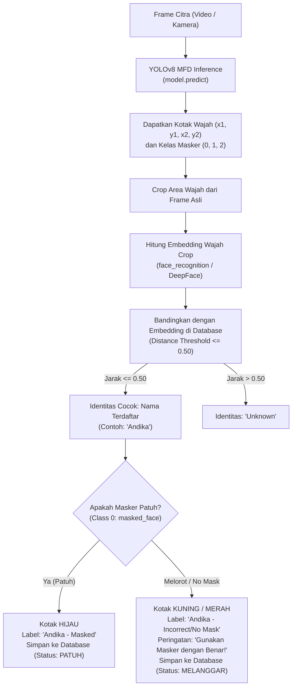

# 📋 PANDUAN LENGKAP & SPESIFIKASI TEKNIS: RETRAINING MODEL & SISTEM ABSENSI CERDAS
**Ditujukan untuk:** Lukman  
**Penanggung Jawab Pengujian Lapangan (Live Webcam Testing):** Andika  
**Proyek:** Masked Face Detection (MFD) & Smart Face Attendance System  
**Repositori:** `c:\Users\andika wahyu pratama\mfd`  

---

## 📌 1. Catatan Khusus & Batasan Tugas Lukman

> ⚠️ **PENTING UNTUK LUKMAN:**  
> Karena **kamera/webcam pada laptop/komputer Lukman sedang bermasalah/tidak aktif**, tugas Lukman **DIBATASI PADA**:
> 1. Menjalankan **pelatihan (*retraining*) model `YOLOv8s`** hingga menghasilkan bobot terbaik yang lebih akurat.
> 2. Membangun **seluruh kode aplikasi web absensi** (Antarmuka Streamlit, Skema Database SQLite, dan Logika Face Recognition).
> 
> 👉 **Lukman TIDAK PERLU melakukan pengujian langsung dengan webcam fisik.**  
> Saat mengembangkan web, Lukman menguji fungsinya menggunakan:
> - **Form Registrasi:** Upload file foto wajah `.jpg` / `.png`.
> - **Layar Presensi:** Mode **"Upload Video / Video Sampel"** (gunakan video yang sudah ada di repositori: [`runs/detect/demo_webcam/0.avi`](file:///c:/Users/andika%20wahyu%20pratama/mfd/runs/detect/demo_webcam/0.avi)).
> - **Pengujian Live Kamera Fisik** akan dilakukan sepenuhnya oleh **Andika** setelah sistem diserahterimakan.

---

## 🚀 2. Tugas 1: Retraining Model YOLOv8s (Panduan Teknis Langkah-demi-Langkah)

### 2.1 Mengapa Harus Dilatih Ulang ke YOLOv8s?
- Model lama: **YOLOv8 Nano (YOLOv8n)** pada [`paket_hasil/masked_face_yolov8n_best.pt`](file:///c:/Users/andika%20wahyu%20pratama/mfd/paket_hasil/masked_face_yolov8n_best.pt) memiliki mAP@50 **84.3%**.
- Pada kelas minoritas `incorrectly_masked_face` (masker melorot), mAP masih di angka **69.3%**.
- Dengan beralih ke **YOLOv8 Small (`yolov8s.pt`)**, parameter model naik dari 3.2M ke 11.2M (3.5x lebih kaya fitur), menaikkan target akurasi mAP@50 ke **88% – 91%**.

### 2.2 Langkah Eksekusi di Terminal PowerShell

> 🔴 **PERINGATAN KERAS – WAJIB PAKAI GPU (CUDA), JANGAN PAKAI CPU!**  
> Dataset ini berisi **31.304 gambar pelatihan**.  
> - **Jika menggunakan CPU:** Proses training bisa memakan waktu **berhari-hari (24–48 jam lebih)** dan komputer akan *freeze/lag* total!  
> - **Wajib menggunakan GPU CUDA (`device=0`):** Waktu training hanya sekitar **3–4 jam** dan berjalan lancar.  
> 
> **Langkah 1: Verifikasi GPU Sebelum Training**  
> Jalankan perintah ini di PowerShell:
> ```powershell
> python -c "import torch; print('CUDA Ready:', torch.cuda.is_available(), '| GPU:', torch.cuda.get_device_name(0) if torch.cuda.is_available() else 'TIDAK TERDETEKSI (CPU)')"
> ```
> * **Jika hasilnya `CUDA Ready: True`:** Berarti GPU aman, langsung lanjut ke Langkah 2.
> * **Jika hasilnya `CUDA Ready: False`:** **JANGAN LANGSUNG TRAINING!** Pasang PyTorch CUDA terlebih dahulu dengan perintah:
>   ```powershell
>   pip install torch torchvision --index-url https://download.pytorch.org/whl/cu132
>   ```
> 
> **Langkah 2: Jalankan Pelatihan dengan Akselerasi GPU (`device=0`)**  
> ```powershell
> yolo detect train `
>   data="fmld_yolo/data.yaml" `
>   model=yolov8s.pt `
>   imgsz=640 `
>   epochs=35 `
>   patience=10 `
>   batch=16 `
>   workers=4 `
>   device=0 `
>   name=fmld_v8s_e35
> ```
> > **Catatan Troubleshooting VRAM:** Jika muncul pesan error `CUDA out of memory`, segera turunkan parameter `batch=16` menjadi `batch=8`. Jangan ubah `device=0` ke CPU!

### 2.3 Evaluasi & Ekspor Model Terbaik
Setelah proses 35 epoch selesai:
```powershell
# 1. Uji metrik mAP pada Test Set resmi (7.152 gambar)
yolo detect val `
  model="runs/detect/fmld_v8s_e35/weights/best.pt" `
  data="fmld_yolo/data.yaml" `
  split=test `
  imgsz=640 `
  device=0 `
  name=test_v8s

# 2. Salin bobot terbaik ke folder hasil proyek
Copy-Item "runs\detect\fmld_v8s_e35\weights\best.pt" -Destination "paket_hasil\masked_face_yolov8s_best.pt"
```

---

## 🗄️ 3. Tugas 2: Arsitektur & Desain Database Sistem Absensi

Gunakan database relasional lokal **SQLite** (`attendance_web/attendance.db`) agar sistem ringan, mandiri, tanpa perlu menginstal server MySQL/PostgreSQL tambahan.

### 3.1 Skema Tabel Database (`attendance.db`)

Lukman wajib membuat 2 tabel berikut:

#### Tabel 1: `users` (Menyimpan Data Anggota Terdaftar)
| Nama Kolom | Tipe Data | Keterangan |
| :--- | :--- | :--- |
| `id` | `INTEGER PRIMARY KEY AUTOINCREMENT` | ID unik sistem |
| `name` | `TEXT NOT NULL` | Nama lengkap anggota (contoh: "Andika Pratama") |
| `identifier` | `TEXT UNIQUE NOT NULL` | NIM / NIP / ID Karyawan (contoh: "12345678") |
| `role` | `TEXT DEFAULT 'Mahasiswa'` | Peran / Jabatan |
| `photo_path` | `TEXT` | Lokasi file foto registrasi (`registered_faces/Andika.jpg`) |
| `created_at` | `TIMESTAMP DEFAULT CURRENT_TIMESTAMP` | Waktu pendaftaran |

#### Tabel 2: `attendance_logs` (Menyimpan Riwayat Presensi Masuk)
| Nama Kolom | Tipe Data | Keterangan |
| :--- | :--- | :--- |
| `id` | `INTEGER PRIMARY KEY AUTOINCREMENT` | ID log presensi |
| `user_id` | `INTEGER` | Relasi ke `users.id` (bisa NULL jika "Unknown") |
| `name` | `TEXT NOT NULL` | Nama yang terdeteksi |
| `identifier` | `TEXT` | NIM / ID yang terdeteksi |
| `mask_status` | `TEXT NOT NULL` | `masked_face`, `unmasked_face`, atau `incorrectly_masked_face` |
| `compliance` | `TEXT NOT NULL` | Status kepatuhan: `'PATUH'` atau `'MELANGGAR'` |
| `confidence` | `REAL` | Nilai keyakinan deteksi (0.00 – 1.00) |
| `timestamp` | `TIMESTAMP DEFAULT CURRENT_TIMESTAMP` | Waktu presensi dicatat |
| `snapshot_path`| `TEXT` | Foto bukti tangkapan saat absen (`logs_snapshots/`) |

---

## 🧠 4. Logika Pipeline Deteksi Masker + Pengenalan Wajah

Aplikasi web menggabungkan **dua model AI secara bersinergi**:
1. **Model Deteksi Masker (YOLOv8):** Mendeteksi koordinat kotak wajah dan menentukan apakah bermasker benar, tanpa masker, atau melorot.
2. **Model Pengenalan Wajah (Face Recognition):** Membaca potongan (*crop*) wajah dari kotak YOLOv8, mengekstrak vektor embedding $128$-dimensi, dan mencocokkannya dengan foto di database menggunakan *Euclidean Distance* / *Cosine Similarity*.



### 4.1 Aturan Pencegahan Duplikasi Presensi (*Cooldown Logic*)
Agar sistem tidak mencatat orang yang sama puluhan kali dalam 1 detik:
- Terapkan **Cooldown 5 Menit**: Jika seseorang sudah berhasil presensi dalam kurun waktu 5 menit terakhir, sistem tetap menampilkan namanya di layar, namun **tidak menduplikasi pencatatan ke database**.

---

## 💻 5. Spesifikasi Antarmuka Web (Streamlit UI Design)

Lukman wajib menggunakan **Streamlit** karena sangat cepat dibangun dan tampilannya profesional secara default.

### 5.1 Struktur Navigasi Halaman (Sidebar / Tabs)
Bagi aplikasi menjadi 3 Tab utama menggunakan `st.tabs()`:

```text
┌────────────────────────────────────────────────────────────────────────┐
│  😷 SMART FACE ATTENDANCE & MASK COMPLIANCE SYSTEM                      │
├────────────────────────────────────────────────────────────────────────┤
│  [ Tab 1: 📸 Presensi Kamera ]  [ Tab 2: 👤 Registrasi ]  [ Tab 3: 📊 Log Riwayat ] │
├────────────────────────────────────────────────────────────────────────┤
│                                                                        │
│  [Konten Tab Terpilih]                                                 │
│                                                                        │
└────────────────────────────────────────────────────────────────────────┘
```

#### Detail Tab 1: 📸 Presensi (Attendance Monitoring)
- **Pengaturan Sumber Masukan (*Input Source*):**
  - Dropdown: `Pilih Sumber -> ["Live Webcam (Testing Andika)", "Upload Video Mandiri", "Video Demo Bawaan"]`.
  - Jika memilih *"Video Demo Bawaan"*, aplikasi langsung memutar file [`runs/detect/demo_webcam/0.avi`](file:///c:/Users/andika%20wahyu%20pratama/mfd/runs/detect/demo_webcam/0.avi). *(Ini fitur kunci agar Lukman bisa menguji tanpa kamera!)*.
- **Tampilan Video Real-time:** Menampilkan bounding box wajah, nama orang, dan label masker.
- **Panel Metrik Samping (Sidebar/Columns):**
  - Kartu jumlah orang hadir hari ini.
  - Kartu persentase kepatuhan masker (% Patuh vs Melanggar).
  - Notifikasi pop-up hijau: *"Presensi Berhasil: [Nama] - Waktu: 09:15 WIB"*.

#### Detail Tab 2: 👤 Registrasi Wajah Baru (Member Registration)
- Form input:
  - Text input: `Nama Lengkap`
  - Text input: `NIM / ID Anggota`
  - Selectbox: `Divisi / Kelas`
  - File uploader: `Upload Foto Wajah (.jpg, .png)` *(Wajib ada agar Lukman bisa daftarkan wajah Andika/Lukman via foto).*
- Tombol: `[ Daftarkan Wajah ]`
  - Memverifikasi apakah wajah terdeteksi pada foto.
  - Menyimpan foto ke `attendance_web/registered_faces/<Nama>.jpg`.
  - Menyimpan data profil ke tabel `users` di database SQLite.
  - Pesan sukses: *"Wajah [Nama] berhasil didaftarkan!"*.

#### Detail Tab 3: 📊 Riwayat & Laporan Absensi (Attendance Log)
- Filter berdasarkan Tanggal dan Status Kepatuhan.
- Menampilkan tabel interaktif Pandas Dataframe yang memuat seluruh riwayat kehadiran.
- Tombol `[ 📥 Unduh Laporan Excel / CSV ]`.

---

## 📂 6. Rekomendasi Struktur File & Modul Kode untuk Lukman

Lukman disarankan menyusun folder kerja secara rapi seperti berikut:

```text
mfd/
├── attendance_web/                  <-- Seluruh pekerjaan Lukman ada di folder ini
│   ├── app.py                       # File antarmuka utama Streamlit
│   ├── db_manager.py                # Modul SQLite (create table, insert, get logs)
│   ├── face_engine.py               # Modul deteksi YOLOv8 + pengenalan wajah
│   ├── registered_faces/            # Tempat penyimpanan foto profil anggota
│   │   ├── Andika.jpg
│   │   └── Lukman.jpg
│   ├── logs_snapshots/              # Tempat penyimpanan foto bukti saat absen
│   └── attendance.db                # Database SQLite (dibuat otomatis)
├── paket_hasil/
│   ├── masked_face_yolov8n_best.pt  # Model baseline (84.3%)
│   └── masked_face_yolov8s_best.pt  # Model baru hasil training Lukman
├── demo_in/                         # 12 sampel gambar uji
├── runs/detect/demo_webcam/0.avi    # File video uji coba untuk Lukman
├── PANDUAN_TUGAS_LUKMAN.md          # Panduan ini
└── requirements.txt
```

---

## 🛠️ 7. Contoh Kode Kerangka Siap Pakai untuk Lukman

Lukman bisa langsung menggunakan potongan kode dasar berikut agar pekerjaannya jauh lebih cepat:

### 7.1 Modul Database (`attendance_web/db_manager.py`)
```python
import sqlite3
from datetime import datetime, timedelta
from pathlib import Path

DB_PATH = Path(__file__).parent / "attendance.db"

def get_connection():
    conn = sqlite3.connect(DB_PATH)
    conn.row_factory = sqlite3.Row
    return conn

def init_db():
    conn = get_connection()
    c = conn.cursor()
    # Tabel Anggota Terdaftar
    c.execute("""
    CREATE TABLE IF NOT EXISTS users (
        id INTEGER PRIMARY KEY AUTOINCREMENT,
        name TEXT NOT NULL,
        identifier TEXT UNIQUE NOT NULL,
        photo_path TEXT NOT NULL,
        created_at TIMESTAMP DEFAULT CURRENT_TIMESTAMP
    )
    """)
    # Tabel Log Presensi
    c.execute("""
    CREATE TABLE IF NOT EXISTS attendance_logs (
        id INTEGER PRIMARY KEY AUTOINCREMENT,
        name TEXT NOT NULL,
        identifier TEXT,
        mask_status TEXT NOT NULL,
        compliance TEXT NOT NULL,
        confidence REAL,
        timestamp TIMESTAMP DEFAULT CURRENT_TIMESTAMP
    )
    """)
    conn.commit()
    conn.close()

def add_user(name, identifier, photo_path):
    conn = get_connection()
    c = conn.cursor()
    try:
        c.execute("INSERT INTO users (name, identifier, photo_path) VALUES (?, ?, ?)",
                  (name, identifier, photo_path))
        conn.commit()
        return True, "Berhasil mendaftarkan wajah."
    except sqlite3.IntegrityError:
        return False, "NIM/ID sudah terdaftar!"
    finally:
        conn.close()

def can_attend(name, cooldown_minutes=5):
    """Cek apakah orang ini sudah absen dalam kurun waktu cooldown."""
    conn = get_connection()
    c = conn.cursor()
    threshold = (datetime.now() - timedelta(minutes=cooldown_minutes)).strftime("%Y-%m-%d %H:%M:%S")
    c.execute("SELECT id FROM attendance_logs WHERE name = ? AND timestamp >= ?", (name, threshold))
    res = c.fetchone()
    conn.close()
    return res is None

def record_attendance(name, identifier, mask_status, compliance, confidence):
    conn = get_connection()
    c = conn.cursor()
    c.execute("""
    INSERT INTO attendance_logs (name, identifier, mask_status, compliance, confidence)
    VALUES (?, ?, ?, ?, ?)
    """, (name, identifier, mask_status, compliance, confidence))
    conn.commit()
    conn.close()
```

### 7.2 Menjalankan Web Streamlit
Lukman cukup menginstal dependensi:
```powershell
pip install streamlit deepface pandas
```
Lalu menjalankan aplikasi:
```powershell
streamlit run attendance_web/app.py
```

---

## 🤝 8. Checklist Serah Terima Tugas ke Andika

Ketika Lukman selesai:
- [ ] Pelatihan model `YOLOv8s` selesai dan file `paket_hasil/masked_face_yolov8s_best.pt` sudah ada.
- [ ] Modul `attendance_web/` dapat berjalan normal tanpa crash saat dijalankan dengan `streamlit run attendance_web/app.py`.
- [ ] Tab registrasi wajah berhasil menyimpan foto dan nama ke SQLite.
- [ ] Mode pemutaran video uji (`0.avi`) sukses menampilkan bounding box masker dan mengenali nama yang didaftarkan.
- [ ] Tab riwayat berhasil membaca tabel presensi dari SQLite dan dapat di-ekspor ke CSV.

Setelah checklist di atas terpenuhi, **Andika akan menyalakan webcam laptop fisiknya, memilih mode "Live Webcam", dan melakukan pengujian presensi langsung di depan kamera.**
